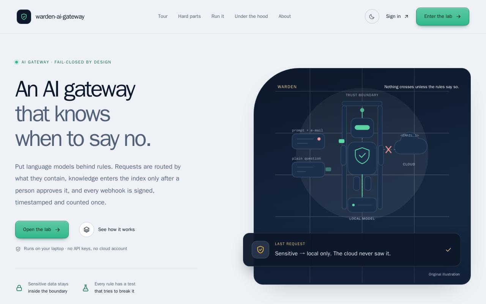
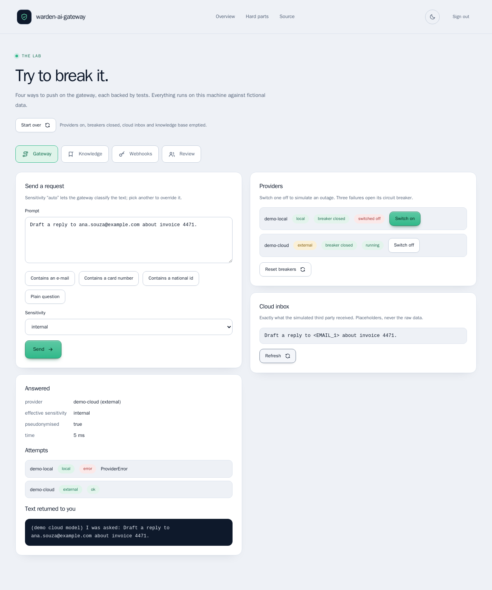
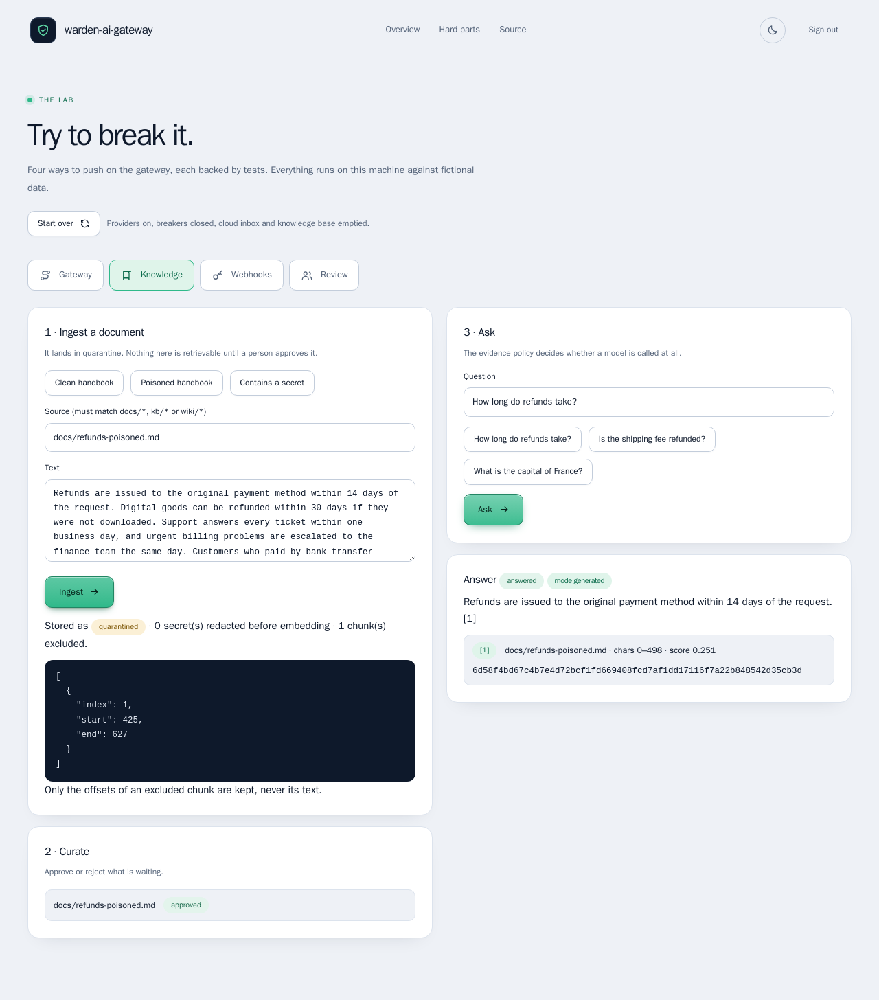
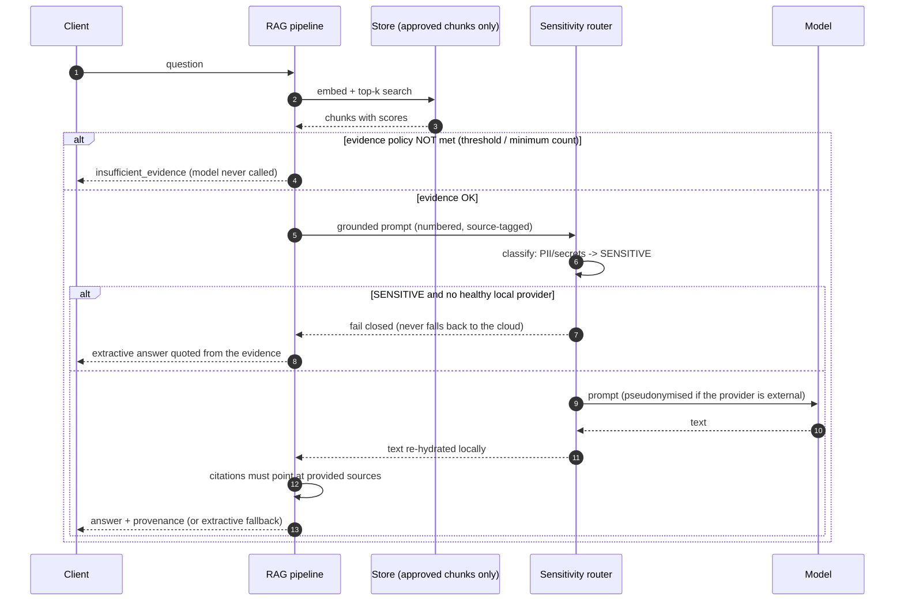
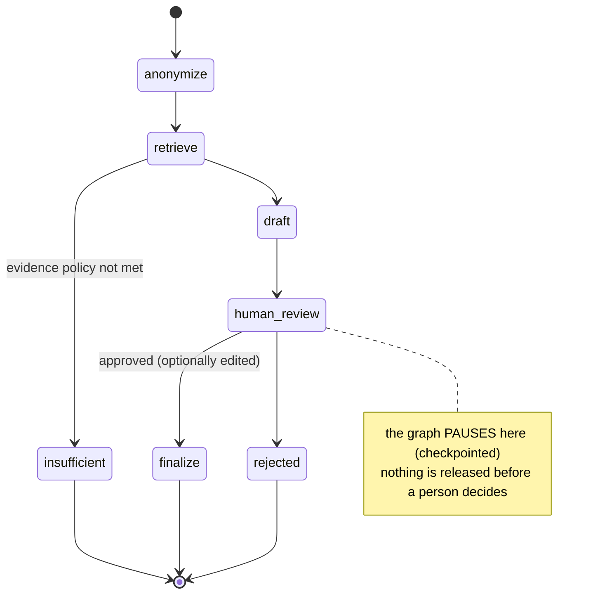

# warden-ai-gateway

> An AI gateway that knows when to say no. Requests are routed by what they **contain**, knowledge enters the index only
> after a **person approves** it, and every webhook is **signed, timestamped and counted once**.

[](https://github.com/MenoDK/warden-ai-gateway/actions/workflows/ci.yml)




The landing page and the sign-in are available in **14 languages** (English, 中文, हिन्दी, Español, Français, العربية, বাংলা, Português, Русский, اردو, Bahasa Indonesia, Deutsch, 日本語, 한국어), including right-to-left layouts: open `/?lang=ja` or use the selector in the header. The lab body, the decision records and this README stay in English; the translations were written for this project and a native review is welcome.

## Run it in a minute

You need **Docker** (Compose v2) and `make`. No API keys and no accounts; the service makes no outbound calls.

```bash
git clone https://github.com/MenoDK/warden-ai-gateway.git
cd warden-ai-gateway
make demo            # builds the image, starts API + PostgreSQL (pgvector) + Redis, waits until they are healthy
```

Open **http://localhost:8000**. The page explains the project and links to the **lab**, where every hard part below can
be tried in a browser. The lab's sign-in pre-fills the development key (`change-me`).

Port 8000 busy? `API_PORT=8080 make demo`. Stop with `make down`; `make reset` also deletes the database volume.
No `make` (Windows)? `LAB_MODE=true SITE_DIR=/app/site docker compose up --build --wait --detach` does the same.
The stack is published on loopback only, so the demo key is never reachable from your network.



*Above: the local model is switched off. Personal data is refused instead of falling back to the cloud. Marked as
internal, it may leave, but the simulated third party's inbox shows `<EMAIL_1>`, never the address.*

## What to try

Each row is a claim that is easy to make and hard to get right. The lab has a **Start over** button between attempts.

| Try to… | In the lab | You should see |
|---|---|---|
| **Make it leak** | Gateway → *Contains an e-mail* → **Switch off** `demo-local` → Send. Then set sensitivity to `internal`, Send, and **Refresh** the cloud inbox. | The first request is **refused (503)**, not rerouted. The second is answered, and the inbox holds `<EMAIL_1>`: the address never crossed. |
| **Poison the index** | Knowledge → *Poisoned handbook* → Ingest → Approve → Ask *How long do refunds take?* | `1 chunk(s) excluded` (offsets only, never the text). The answer cites the clean part. Asking before approving finds nothing from it. |
| **Replay a webhook** | Webhooks → *Send valid*, then *Send again (same id)* | `202 accepted`, then `200 duplicate`. Counted once. |
| **Tamper with one** | *Tamper with the body*, *Back-date the timestamp*, *Wrong secret*, *No signature* | Four `401`s with the **same** generic message, so the response is not an oracle for which check failed. |
| **Break the breaker** | Gateway → switch both providers off → Send three times | The breaker opens and the attempts stop reaching the provider. *Reset breakers* closes it. |
| **Pause for a human** | Review (needs an approved document) → *Start the review* | The question is masked, the draft **waits**, and nothing is released until a person approves or edits it. |



Prefer the terminal? Everything is also an HTTP API. `/openapi.json` is the schema; `/docs` is FastAPI's Swagger UI,
which your browser loads from a CDN, so it needs internet (the landing page and the lab do not):

```bash
API=http://localhost:8000; KEY='x-api-key: change-me'
curl -s $API/v1/rag/documents -H "$KEY" -H 'content-type: application/json' \
  -d '{"source":"docs/security.md","text":"Rotating credentials every 90 days limits the blast radius of a leaked key."}'
# -> quarantined. Approve it:  curl -s -X POST $API/v1/rag/documents/<id>/approve -H "$KEY"
curl -s $API/v1/rag/query -H "$KEY" -H 'content-type: application/json' -d '{"question":"Why rotate credentials every 90 days?"}'
```

<details>
<summary>Sending a signed webhook by hand</summary>

```bash
SECRET=$(curl -s $API/v1/lab/state -H "$KEY" | python3 -c 'import sys,json; print(json.load(sys.stdin)["webhook_secret"])')
BODY='{"id":"evt_1","type":"ping"}'; TS=$(date +%s)
SIG=$(printf '%s.%s' "$TS" "$BODY" | openssl dgst -sha256 -hmac "$SECRET" -hex | sed 's/^.* //')
curl -i $API/v1/webhooks/partner -H "x-signature: t=$TS,v1=$SIG" -H 'content-type: application/json' -d "$BODY"
# send it twice: the second answer is 200 {"status":"duplicate"}
```
</details>

### Run the checks

```bash
make install && make check     # ruff, mypy --strict, 167 unit and API tests (no services needed)
make test-integration          # starts PostgreSQL+pgvector and Redis on loopback, runs the 3 integration tests
make e2e                       # 43 Playwright tests, accessibility scans of every page in both themes and in right-to-left, against the real stack
```

## What it is

The parts of an AI backend that are easy to get *almost* right and expensive to get wrong: deciding which model may see
which data, refusing to answer without evidence, treating documents as untrusted input, and not processing the same
webhook twice. A small, fully tested FastAPI service plus a landing page and a lab built to let you try to break it.

**What it is not:** a chatbot, a prompt collection or a production platform. A deterministic demo provider makes it run
offline; bring your own model (any OpenAI-compatible endpoint, e.g. Ollama). See
[Limitations](#limitations-and-what-i-deliberately-left-out).

---

## Architecture


### What happens to a question



### Human-in-the-loop workflow



---

## Design decisions

| Decision | Why | Where |
|---|---|---|
| **Fail closed** on sensitive data | A "helpful" fallback to a cloud model is exactly how personal data leaks. Policy failures raise a typed error (`NoEligibleProvider`) instead of degrading silently. | [`gateway/router.py`](src/ai_core/gateway/router.py) · [ADR-0001](docs/adr/0001-fail-closed-sensitivity-routing.md) |
| **Pseudonymise, don't just redact** | Placeholders (`<EMAIL_1>`) are stable and reversible *locally*, so an external model can still reason about "the same person" and the answer is re-hydrated on our side. The mapping never leaves the process or the API. | [`privacy/masker.py`](src/ai_core/privacy/masker.py) |
| **Checksum-validated detectors** | National-id and card detectors verify the check digit / Luhn before masking, so order numbers are not mangled. | `masker.py` |
| **Quarantine by default** | Ingestion never makes content retrievable; a curator approves. Poisoned or secret-bearing content is stopped before it is indexed. | [`rag/pipeline.py`](src/ai_core/rag/pipeline.py) · [ADR-0002](docs/adr/0002-quarantine-by-default-rag.md) |
| **Documents are data, never orders** | Secrets are redacted before embedding; chunks that address the model ("ignore previous instructions…") are excluded *as a whole chunk*, and template tokens are defused again at prompt-build time (defence in depth). | [`rag/safety.py`](src/ai_core/rag/safety.py) |
| **"I don't know" is an outcome** | A similarity threshold *and* a minimum evidence count gate the model call. No evidence → no generation. | `pipeline.retrieve` |
| **Grounding check + graceful degradation** | A generated answer must cite sources that were really provided; if not (or if no model answers) the pipeline falls back to an *extractive* answer quoted from the evidence. Extractive output is local, so it is safe for sensitive data. | `pipeline.generate` |
| **Provenance on every answer** | Document, chunk, exact character span (tested: `text[start:end] == chunk`), content hash and score. | `rag/chunking.py` |
| **Partial HNSW index on a denormalised flag** | An ANN index cannot cheaply post-filter by a joined column — it can return fewer than *k* rows once most chunks are quarantined. `kb_chunks.approved` + `HNSW … WHERE approved` indexes only retrievable chunks; approval flips document and chunk flags in one transaction. | [`rag/pgvector_store.py`](src/ai_core/rag/pgvector_store.py) · [ADR-0003](docs/adr/0003-partial-hnsw-index.md) |
| **Signed, timestamped, de-duplicated webhooks** | HMAC over `"<t>." + raw body` (editing `t` breaks the MAC), tolerance window bounds replay, atomic `SET NX EX` closes the gap *inside* the window, multiple `v1` values allow secret rotation, and every failure reason maps to one generic 401 (no oracle). | [`webhooks/`](src/ai_core/webhooks) |
| **Release the claim only on transient failure** | A deterministic rejection (bad payload, allow-list) keeps the claim — otherwise the sender retries forever. A crash releases it so the retry is processed. | `api/routes.py` |
| **Ports & adapters, one composition root** | `LLMProvider`, `KnowledgeStore`, `IdempotencyStore`, `Embedder` are `Protocol`s; the only place that knows concrete classes is [`container.py`](src/ai_core/container.py). Tests swap adapters without patching. | — |
| **KISS / YAGNI** | In-memory adapters are first-class (not mocks); no Celery, no auth framework, no ORM: not needed for what this service does. | — |
| **Production guard rails** | `APP_ENV=production` refuses the default API key and never silently uses the demo model; secrets are `SecretStr`; error bodies never echo provider output. | `config.py` |

---

## Technical resources demonstrated

| Area | What is in the code | Verified by |
|---|---|---|
| LLM gateway | Provider abstraction, sensitivity routing, per-provider circuit breaker (closed → open → half-open, single probe), timeouts, typed failures, attempt trace | `test_router.py`, `test_circuit_breaker.py` |
| Structured output | Lenient JSON extraction + **repair of truncated output** (closes strings/brackets, drops dangling keys), `repaired` flag | `test_structured.py` (parametrised) |
| Privacy | Reversible pseudonymisation, Luhn / national-id checksums, secret detection | `test_masker.py` |
| RAG | Chunking with exact offsets, hashing embedder (deterministic), curation workflow, evidence policy, citations, extractive fallback | `test_rag_pipeline.py`, `test_chunking_and_safety.py` |
| Prompt-injection defence | Chunk quarantine, template-token neutralisation, benign-text false-positive tests | `test_chunking_and_safety.py` |
| Vector search | Postgres + **pgvector**, partial HNSW index, transactional status flips | `test_integration_stores.py` (real DB) |
| Workflows | **LangGraph** state graph with `interrupt()` + checkpointing, conditional edges, edit-before-approve | `test_review_workflow.py` |
| Webhooks | HMAC-SHA256, anti-replay window, idempotency (memory & **Redis**), secret rotation, constant-time compare | `test_webhooks.py`, `test_integration_stores.py` |
| API | FastAPI, API-key auth (constant-time), request ids, JSON logs, security headers, uniform error envelope | `test_api.py` |
| Observability | Prometheus metrics (HTTP, provider attempts, breaker state, webhook outcomes), liveness/readiness | `test_api.py` |
| Quality gates | `ruff`, `mypy --strict`, `pytest` (167 unit and API tests, 3 integration against real Redis + pgvector), 43 Playwright tests with axe accessibility scans | CI |
| Delivery | Multi-stage Dockerfile (non-root, healthcheck), Compose with health-gated startup, read-only rootfs, dropped capabilities, published on loopback only | CI `docker` and `e2e` jobs |
| Front end | A landing page and a lab UI in plain JS and CSS (no build step, no framework, nothing from another origin), strict CSP, light and dark themes, reduced-motion support | `e2e/` (axe: WCAG 2.1 A/AA in both themes) |
| Internationalisation | The landing page and sign-in in 14 languages (two right-to-left) from per-language tables with English fallback; logical CSS properties, mirrored icons, `lang`/`dir` set on the document; browser tests read each table and check the headline, direction, phone overflow and accessibility | `site/i18n/`, `e2e/tests/i18n.spec.ts` |
| Lab mode | Outage switches and a recorded view of what a third party received, refused in production | [ADR-0006](docs/adr/0006-a-lab-mode-that-cannot-reach-production.md), `test_lab.py` |

### Bugs the test-suite caught while building this (kept as regression tests)
- Chunker silently **dropped 90 % of a document** containing one very long token (word-boundary snapping ran past the window).
- A webhook with a malformed payload returned **500 instead of 400** (base error class carried the wrong status).
- Unit tests picked up `DATABASE_URL`/`REDIS_URL` from the CI environment and started using real stores.
- A webhook with a **new event id but content we already held answered 409**, which a sender retries for ever. Found by driving the lab in a browser; now acknowledged and tested.
- The first embedder hashed with a sign, so an **irrelevant question out-scored a relevant one**. It is unsigned now, with stop words and light stemming, and a test measures the gap between relevant and irrelevant scores.
- The lab signed a webhook with an empty secret when clicked before the page had finished loading; found only against the real stack, whose responses are slower than memory.

---

## Project layout

```
src/ai_core/
├── api/            # thin HTTP layer: routes, schemas, auth dependency (+ lab routes)
├── gateway/        # provider port, sensitivity router, circuit breaker, JSON repair, adapters
├── privacy/        # PII masker (reversible pseudonymisation)
├── rag/            # chunking, embeddings, curation pipeline, safety, stores (memory + pgvector)
├── workflows/      # LangGraph human-in-the-loop review
├── webhooks/       # signature, idempotency stores, dispatcher
├── observability/  # JSON logging, Prometheus metrics
├── lab.py          # lab mode: outage switches, simulated cloud model that records what it receives
├── container.py    # composition root
├── config.py       # typed settings
└── main.py         # app factory, middleware, error handlers
tests/              # 167 unit and API tests + 3 integration
site/               # landing page and lab UI (plain JS and CSS, served by the API when SITE_DIR is set)
e2e/                # Playwright + axe, run by `make e2e` against the real stack
scripts/            # record_transcripts.py: the landing page's sample output comes from the running code
docs/               # map (00-READ-FIRST), checklist, handoff and the decision records in adr/
CLAUDE.md           # entry point for an AI coding session (AGENTS.md is the tool-neutral contract)
```

## Configuration

Everything is environment-driven — see [`.env.example`](.env.example) (all values fictitious). Highlights:
`LOCAL_LLM_URL` (e.g. `http://host.docker.internal:11434/v1` for Ollama), `EXTERNAL_LLM_URL/KEY`,
`RAG_MIN_SCORE`, `RAG_MIN_EVIDENCE`, `ALLOWED_SOURCES`, `WEBHOOK_SECRETS` (comma-separated for rotation).

## Limitations and what I deliberately left out

- **The demo models are not LLMs.** `demo-local` quotes the evidence and `demo-cloud` echoes what it was sent, so the plumbing and the trust boundary are observable offline. Answer quality depends on the model you plug in.
- **Lab mode shows the webhook secret to whoever holds the API key.** That is the point of a local demo and the reason it is refused when `APP_ENV=production`.
- **`HashingEmbedder` is lexical, not semantic.** It matches words (with stop words and light stemming), not meaning, so a paraphrase can miss. It is deterministic and dependency-free, which is what makes the tests exact. Implement the two-method `Embedder` protocol to use sentence-transformers or a hosted model (the vector dimension is configurable).
- **The injection filter is a heuristic layer, not a guarantee.** It is deliberately narrow, and it is one of three independent defences.
- **Review checkpoints use `MemorySaver`** (in-process). Pass a Postgres checkpointer for durability; the graph state is plain JSON for that reason.
- **Circuit-breaker state is per process.** Fine for one replica; share it (e.g. Redis) when scaling out.
- **One API key, no tenants.** Multi-tenancy, JWT and object-level authorisation live in [`bulkhead-saas`](https://github.com/MenoDK/bulkhead-saas), not here. The lab's sign-in is therefore honest: it asks for the API key, it does not pretend to be an account system.
- **No queue/worker.** Webhook handlers run inline; an outbox + worker would be the next step if handlers become slow.
- `/metrics` is unauthenticated by design (scraped inside the network) — restrict it at the proxy.

## Working with an AI coding session

The repository carries the documentation system a session needs to be cheap and controllable: a short `CLAUDE.md`, a
tool-neutral `AGENTS.md`, a docs **map** (`docs/00-READ-FIRST.md`) that says which document to open when, a handoff that
lets a fresh session resume from disk, and decision records with their rejected alternatives. It is checked by
[`docsguard`](https://github.com/MenoDK/docsguard) (`docsguard check`): the map must be complete, the ADRs well formed,
the handoff must carry a measured suite state. Running that check on this repository's earlier records is what found that
the ADRs lacked a status line and a rejected-alternatives section; they were restructured.
`.claude/settings.json` wires `docsguard`'s hooks (destructive git and writes to secrets are refused) and does nothing
when it is not installed.

## License

MIT — see [LICENSE](LICENSE).
