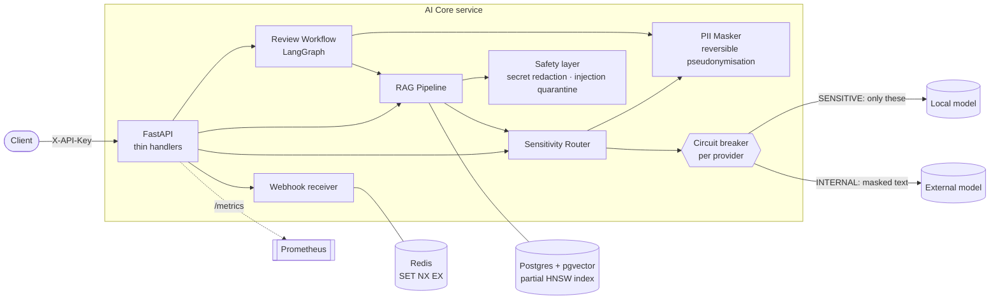
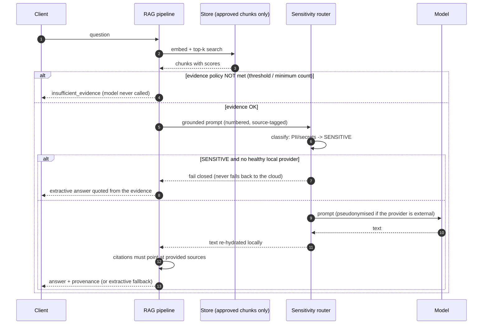
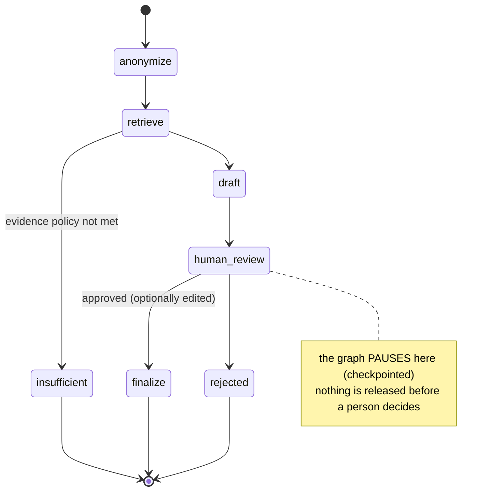

# AI Core

> A reference architecture for putting LLMs behind a **fail-closed gateway**, grounding them with **curated RAG**,
> keeping a **human in the loop**, and accepting **hardened webhooks** — in a small, fully tested FastAPI service.

[](https://github.com/MenoDK/showcase-python-ai-core/actions/workflows/ci.yml)


**What it is.** The parts of an AI backend that are easy to get *almost* right and expensive to get wrong:
deciding which model may see which data, refusing to answer without evidence, treating documents as untrusted
input, and not processing the same webhook twice.

**What it is not.** A chatbot, a prompt collection or a production platform. There is a deterministic *demo*
provider so everything runs offline; bring your own model (any OpenAI-compatible endpoint, e.g. Ollama).
See [Limitations](#limitations-and-what-i-deliberately-left-out).

---

## Quick start

```bash
cp .env.example .env          # all values are placeholders; set API_KEY
docker compose up --build     # api + Postgres/pgvector + Redis, all with health checks
```

```bash
API=http://localhost:8000; KEY='x-api-key: change-me'

# 1. ingest -> lands in QUARANTINE (not retrievable yet)
curl -s $API/v1/rag/documents -H "$KEY" -H 'content-type: application/json' \
  -d '{"source":"docs/security.md","text":"Rotating credentials every 90 days limits the blast radius of a leaked key."}'

# 2. a curator approves it
curl -s -X POST $API/v1/rag/documents/<id>/approve -H "$KEY"

# 3. ask: answered with provenance (document, chunk, character span, content hash, score)
curl -s $API/v1/rag/query -H "$KEY" -H 'content-type: application/json' \
  -d '{"question":"Why rotate credentials every 90 days?"}'

# 4. personal data is detected and routed to a LOCAL provider only
curl -s $API/v1/completions -H "$KEY" -H 'content-type: application/json' \
  -d '{"prompt":"Summarise the ticket from ana@example.com"}'
```

Interactive docs: `http://localhost:8000/docs` · metrics: `/metrics` · readiness: `/health/ready`.

<details>
<summary>Sending a signed webhook</summary>

```bash
SECRET=whsec_example_current            # from WEBHOOK_SECRETS in .env
BODY='{"id":"evt_1","type":"ping"}'; TS=$(date +%s)
SIG=$(printf '%s.%s' "$TS" "$BODY" | openssl dgst -sha256 -hmac "$SECRET" -hex | sed 's/^.* //')
curl -i $API/v1/webhooks/partner -H "x-signature: t=$TS,v1=$SIG" -H 'content-type: application/json' -d "$BODY"
# send it twice: the second answer is 200 {"status":"duplicate"}
```
</details>

Local development without Docker: `make install && make check` (lint + `mypy --strict` + tests).

---

## Architecture



### What happens to a question



### Human-in-the-loop workflow



---

## Design decisions

| Decision | Why | Where |
|---|---|---|
| **Fail closed** on sensitive data | A "helpful" fallback to a cloud model is exactly how personal data leaks. Policy failures raise a typed error (`NoEligibleProvider`) instead of degrading silently. | [`gateway/router.py`](src/ai_core/gateway/router.py) · [ADR-0001](docs/adr/0001-fail-closed-sensitivity-routing.md) |
| **Pseudonymise, don't just redact** | Placeholders (`<EMAIL_1>`) are stable and reversible *locally*, so an external model can still reason about "the same person" and the answer is re-hydrated on our side. The mapping never leaves the process or the API. | [`privacy/masker.py`](src/ai_core/privacy/masker.py) |
| **Checksum-validated detectors** | National-id and card detectors verify the check digit / Luhn before masking, so order numbers are not mangled. | `masker.py` |
| **Quarantine by default** | Ingestion never makes content retrievable; a curator approves. Poisoned or secret-bearing content is stopped before it is indexed. | [`rag/pipeline.py`](src/ai_core/rag/pipeline.py) · [ADR-0002](docs/adr/0002-quarantine-by-default-rag.md) |
| **Documents are data, never orders** | Secrets are redacted before embedding; chunks that address the model ("ignore previous instructions…") are excluded *as a whole chunk*, and template tokens are defused again at prompt-build time (defence in depth). | [`rag/safety.py`](src/ai_core/rag/safety.py) |
| **"I don't know" is an outcome** | A similarity threshold *and* a minimum evidence count gate the model call. No evidence → no generation. | `pipeline.retrieve` |
| **Grounding check + graceful degradation** | A generated answer must cite sources that were really provided; if not (or if no model answers) the pipeline falls back to an *extractive* answer quoted from the evidence. Extractive output is local, so it is safe for sensitive data. | `pipeline.generate` |
| **Provenance on every answer** | Document, chunk, exact character span (tested: `text[start:end] == chunk`), content hash and score. | `rag/chunking.py` |
| **Partial HNSW index on a denormalised flag** | An ANN index cannot cheaply post-filter by a joined column — it can return fewer than *k* rows once most chunks are quarantined. `kb_chunks.approved` + `HNSW … WHERE approved` indexes only retrievable chunks; approval flips document and chunk flags in one transaction. | [`rag/pgvector_store.py`](src/ai_core/rag/pgvector_store.py) · [ADR-0003](docs/adr/0003-partial-hnsw-index.md) |
| **Signed, timestamped, de-duplicated webhooks** | HMAC over `"<t>." + raw body` (editing `t` breaks the MAC), tolerance window bounds replay, atomic `SET NX EX` closes the gap *inside* the window, multiple `v1` values allow secret rotation, and every failure reason maps to one generic 401 (no oracle). | [`webhooks/`](src/ai_core/webhooks) |
| **Release the claim only on transient failure** | A deterministic rejection (bad payload, allow-list) keeps the claim — otherwise the sender retries forever. A crash releases it so the retry is processed. | `api/routes.py` |
| **Ports & adapters, one composition root** | `LLMProvider`, `KnowledgeStore`, `IdempotencyStore`, `Embedder` are `Protocol`s; the only place that knows concrete classes is [`container.py`](src/ai_core/container.py). Tests swap adapters without patching. | — |
| **KISS / YAGNI** | In-memory adapters are first-class (not mocks); no Celery, no auth framework, no ORM: not needed for what this service does. | — |
| **Production guard rails** | `APP_ENV=production` refuses the default API key and never silently uses the demo model; secrets are `SecretStr`; error bodies never echo provider output. | `config.py` |

---

## Technical resources demonstrated

| Area | What is in the code | Verified by |
|---|---|---|
| LLM gateway | Provider abstraction, sensitivity routing, per-provider circuit breaker (closed → open → half-open, single probe), timeouts, typed failures, attempt trace | `test_router.py`, `test_circuit_breaker.py` |
| Structured output | Lenient JSON extraction + **repair of truncated output** (closes strings/brackets, drops dangling keys), `repaired` flag | `test_structured.py` (parametrised) |
| Privacy | Reversible pseudonymisation, Luhn / national-id checksums, secret detection | `test_masker.py` |
| RAG | Chunking with exact offsets, hashing embedder (deterministic), curation workflow, evidence policy, citations, extractive fallback | `test_rag_pipeline.py`, `test_chunking_and_safety.py` |
| Prompt-injection defence | Chunk quarantine, template-token neutralisation, benign-text false-positive tests | `test_chunking_and_safety.py` |
| Vector search | Postgres + **pgvector**, partial HNSW index, transactional status flips | `test_integration_stores.py` (real DB) |
| Workflows | **LangGraph** state graph with `interrupt()` + checkpointing, conditional edges, edit-before-approve | `test_review_workflow.py` |
| Webhooks | HMAC-SHA256, anti-replay window, idempotency (memory & **Redis**), secret rotation, constant-time compare | `test_webhooks.py`, `test_integration_stores.py` |
| API | FastAPI, API-key auth (constant-time), request ids, JSON logs, security headers, uniform error envelope | `test_api.py` |
| Observability | Prometheus metrics (HTTP, provider attempts, breaker state, webhook outcomes), liveness/readiness | `test_api.py` |
| Quality gates | `ruff`, `mypy --strict`, `pytest` (140 tests: unit, API, 2 integration against real Redis + pgvector) | CI |
| Delivery | Multi-stage Dockerfile (non-root, healthcheck), Compose with health-gated startup, read-only rootfs, dropped capabilities | CI `docker` job |

### Bugs the test-suite caught while building this (kept as regression tests)
- Chunker silently **dropped 90 % of a document** containing one very long token (word-boundary snapping ran past the window).
- A webhook with a malformed payload returned **500 instead of 400** (base error class carried the wrong status).
- Unit tests picked up `DATABASE_URL`/`REDIS_URL` from the CI environment and started using real stores.

---

## Project layout

```
src/ai_core/
├── api/            # thin HTTP layer: routes, schemas, auth dependency
├── gateway/        # provider port, sensitivity router, circuit breaker, JSON repair, adapters
├── privacy/        # PII masker (reversible pseudonymisation)
├── rag/            # chunking, embeddings, curation pipeline, safety, stores (memory + pgvector)
├── workflows/      # LangGraph human-in-the-loop review
├── webhooks/       # signature, idempotency stores, dispatcher
├── observability/  # JSON logging, Prometheus metrics
├── container.py    # composition root
├── config.py       # typed settings
└── main.py         # app factory, middleware, error handlers
tests/              # 140 tests
docs/adr/           # architecture decision records
```

## Configuration

Everything is environment-driven — see [`.env.example`](.env.example) (all values fictitious). Highlights:
`LOCAL_LLM_URL` (e.g. `http://host.docker.internal:11434/v1` for Ollama), `EXTERNAL_LLM_URL/KEY`,
`RAG_MIN_SCORE`, `RAG_MIN_EVIDENCE`, `ALLOWED_SOURCES`, `WEBHOOK_SECRETS` (comma-separated for rotation).

## Limitations and what I deliberately left out

- **The demo model is not an LLM.** It quotes the top evidence so the plumbing is observable offline. Quality of answers depends on the model you plug in.
- **`HashingEmbedder` is lexical, not semantic.** It is deterministic and dependency-free, which is what makes the tests exact. Implement the two-method `Embedder` protocol to use sentence-transformers or a hosted model (the vector dimension is configurable).
- **The injection filter is a heuristic layer, not a guarantee.** It is deliberately narrow, and it is one of three independent defences.
- **Review checkpoints use `MemorySaver`** (in-process). Pass a Postgres checkpointer for durability; the graph state is plain JSON for that reason.
- **Circuit-breaker state is per process.** Fine for one replica; share it (e.g. Redis) when scaling out.
- **One API key, no tenants.** Multi-tenancy, JWT and object-level authorisation live in the sibling project, not here.
- **No queue/worker.** Webhook handlers run inline; an outbox + worker would be the next step if handlers become slow.
- `/metrics` is unauthenticated by design (scraped inside the network) — restrict it at the proxy.

## License

MIT — see [LICENSE](LICENSE).
